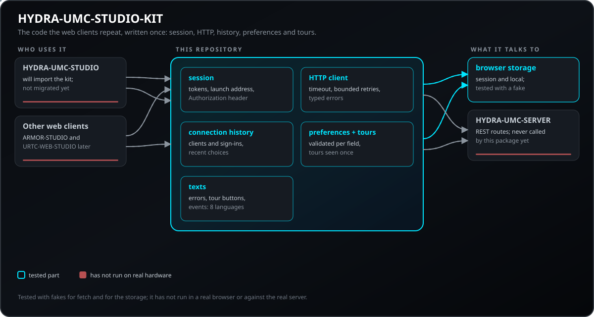
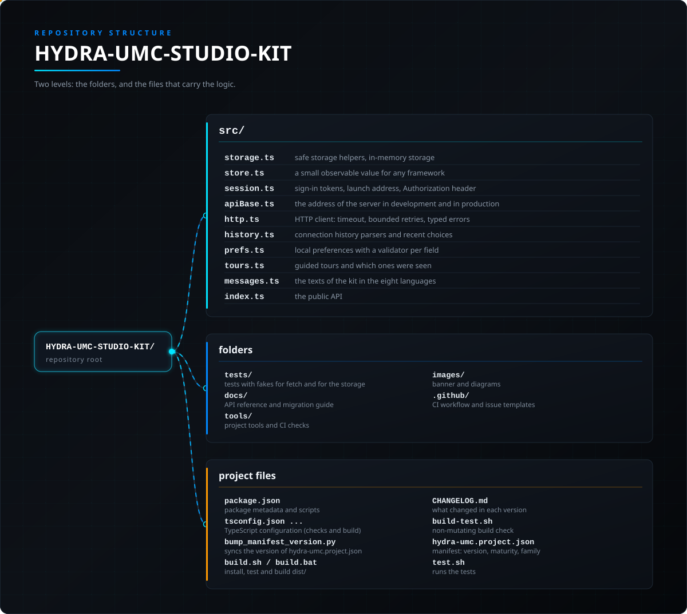

<!-- =============================================================================
HYDRA-UMC-STUDIO-KIT - Shared code of the HYDRA-UMC web clients
Copyright (C) JuanenRac (Electro Hobby 3D) <electrohobby3d@gmail.com>
GPL-3.0-or-later - see LICENSE
============================================================================= -->

<p align="center">
  
</p>

# 🧰 HYDRA-UMC-STUDIO-KIT

<p align="center"><a href="README.md">🇺🇸 English</a> | 🇪🇸 <b>Español</b> | <a href="README_fra.md">🇫🇷 Français</a> | <a href="README_ita.md">🇮🇹 Italiano</a> | <a href="README_deu.md">🇩🇪 Deutsch</a> | <a href="README_zho.md">🇨🇳 简体中文</a> | <a href="README_jpn.md">🇯🇵 日本語</a> | <a href="README_por.md">🇵🇹 Português</a></p>

### 🧰 El código que repiten los clientes web de HYDRA-UMC, escrito una sola vez: sesión, HTTP, historial, preferencias y recorridos

<p align="center">
  
  
  
  
  
  
</p>

---

**Comprobación de honestidad - lo que funciona hoy:** la sesión, el cliente HTTP, la resolución de la dirección, los lectores del historial de conexiones, las preferencias locales, la lista reciente, los recorridos y los textos son reales y están probados (87 pruebas pasan), siempre contra simulaciones de `fetch` y del almacenamiento: nada se ha ejecutado todavía en un navegador real ni contra un HYDRA-UMC-SERVER real. HYDRA-UMC-STUDIO aún no consume el kit, así que hoy ninguna pantalla de ningún cliente lo usa. Los recorridos guiados son código nuevo: ningún cliente tiene un recorrido que sustituir. Consulta `CHANGELOG.md` para ver exactamente qué se ha entregado hasta ahora.

---

> **Estado de seguridad física y de ciberseguridad:** este ecosistema no es un sistema de seguridad certificado. Todavía no existe una ruta de E-STOP por hardware, ni límites ni enclavamientos aplicados por el firmware, ni un comando de movimiento verificado; las imágenes de firmware se comprueban con CRC-32 y una firma Ed25519, y una compilación de versión rechaza las claves de desarrollo publicadas (los cabezales de herramienta y las placas de expansión detrás del relé siguen con cargadores de URTC, que usan un HMAC-SHA256 de clave compartida en lugar de una firma); TLS y TLS mutuo son opcionales y están desactivados por defecto; aún no se ha poblado ni probado ninguna placa propia. Lee la [línea base de seguridad](https://github.com/JuanenRac/HYDRA-UMC-DOCS/blob/main/docs/SECURITY_BASELINE.md) y el [modelo de amenazas](https://github.com/JuanenRac/HYDRA-UMC-DOCS/blob/main/docs/THREAT_MODEL.md) antes de fiarte de cualquier afirmación de aquí para la seguridad de una persona.

---

## 📋 De un vistazo

| | |
|---|---|
| Versión | `0.0.4` |
| Madurez | Andamiaje |
| Tests | 87 (`npm test`) |
| Tecnología | TypeScript / Vitest |
| Destino | Un navegador web en el PC del usuario |
| En hardware real | No aplica: nada de esto se ejecuta en hardware |

**Ir a:** [Resumen](#-resumen) · [Arquitectura](#-arquitectura) · [Inicio rápido](#-inicio-rápido) · [Pruebas](#-pruebas) · [Estructura del repositorio](#-estructura-del-repositorio) · [Proyectos relacionados](#-proyectos-relacionados)

## 🚦 Estado del proyecto

Cada línea es una parte de este repositorio y la luz dice hasta dónde llega hoy. Se escribe con lo que el repositorio puede demostrar (pruebas, compilaciones, ejecuciones), no con lo previsto.

🟢 Hecho y verificado · 🟡 Funciona, con límites conocidos · 🟠 Hecho a medias o sin verificar · 🔴 Sin hacer o sin funcionar

| Área | Estado | Qué significa aquí |
|---|---|---|
| Software | 🟠 | Solo estructura y primeras piezas; falta la mayor parte del trabajo |
| Pruebas | 🟡 | 87 pruebas automáticas, ejecutadas en cada cambio |
| Hardware real | 🟡 | No aplica: nada de esto se ejecuta en hardware |
| Interfaz y protocolos | 🟡 | Las rutas o los mensajes que ofrece están documentados y probados con un cliente; aún no los han usado todos los clientes |
| Integración | 🟠 | Funciona por sí solo; su enlace con el resto del ecosistema aún no se ha ejercitado |
| Seguridad | 🟡 | El control de acceso, los límites de entrada o las firmas están implementados y probados en un ordenador; nadie ajeno al proyecto los ha revisado |
| Idiomas y accesibilidad | 🟡 | La interfaz y su ayuda están en ocho idiomas; el uso con teclado y lector de pantalla no se ha probado |
| Documentación | 🟡 | README en ocho idiomas, comprobado contra el manifiesto en cada cambio |

## 🎯 Resumen

**HYDRA-UMC-STUDIO-KIT** es un paquete pequeño de TypeScript sin framework y sin dependencias de ejecución. Reúne el código que necesita todo cliente web de HYDRA-UMC y que, si no, se copiaría de un cliente a otro: dónde viven los tokens de sesión, cómo se hace una llamada al servidor, cómo se lee el historial de conexiones del servidor, cómo se recuerdan las elecciones locales de una persona y cómo un recorrido guiado sabe qué se ha mostrado ya.

### Características principales:
* 🔑 **Sesión:** los tokens de acceso y de renovación van por defecto al almacenamiento de sesión y al local solo cuando la persona marca «mantener la sesión iniciada»; un token que llega en la dirección se lee del fragmento, se guarda solo para esa vista y se quita de la dirección. La forma `?token=` es un interruptor, apagado por defecto.
* 🌐 **Cliente HTTP:** tiempo límite en cada intento, reintentos acotados con espera creciente para las llamadas seguras de repetir (nunca un POST por sí solo), `Retry-After`, una renovación del token ante un 401 y un `HttpError` tipado (red, tiempo, cancelada, http, lectura) cuyo texto nunca contiene el token. El token solo va al origen configurado.
* 🕘 **Historial:** lectores de la lista de clientes y del historial de inicios de sesión del servidor (un servidor antiguo responde «no soportado» en vez de fallar) y una lista acotada de las elecciones recientes de la persona.
* ⚙️ **Preferencias:** elecciones locales con un validador por campo; lo que haya en el almacenamiento se convierte en un valor válido o en el valor por defecto, y un almacenamiento que falla nunca rompe una pantalla.
* 🧭 **Recorridos:** el estado de un recorrido guiado y cuáles se han visto; un recorrido nunca empieza solo salvo que la aplicación lo pida, y se ofrece de nuevo cuando sube su versión.
* 🌍 **Ocho idiomas:** los errores, los botones del recorrido y los nombres de los eventos de inicio de sesión en en, es, de, fr, it, ja, zh y pt (portugués de Portugal).

El kit no dibuja nada: un cliente React enlaza cualquiera de sus almacenes con `useSyncExternalStore(store.subscribe, store.get)`. HYDRA-UMC-STUDIO es el primer cliente pensado para usarlo y todavía no lo consume; `docs/MIGRATION.md` enumera qué sustituye y cómo se comprueba cada paso.

## 🧩 Papel en HYDRA-UMC

**HYDRA-UMC-STUDIO-KIT** es el código que los clientes web de la familia, si no, se copiarían unos a otros: la sesión, el cliente HTTP, el historial de conexiones, las preferencias locales y los recorridos guiados, como un paquete de TypeScript sin framework y sin dependencias de ejecución. HYDRA-UMC-STUDIO es el primer cliente pensado para usarlo y todavía no lo consume.

## 🏛️ Arquitectura

<p align="center">
  
</p>

### ARQUITECTURA Y DECISIONES DE DISEÑO

* **Por qué un paquete y no otra copia.** La sesión, la dirección del servidor, el historial de conexiones y las preferencias locales se escribieron en HYDRA-UMC-STUDIO y los necesita igual cualquier otro cliente web; una corrección hecha en una copia nunca se hacía en las demás.
* **Por qué sin framework.** Cada almacén tiene `get` y `subscribe`, la forma que espera `useSyncExternalStore`, así que React lo enlaza en una línea y otro framework (o ninguno) lo usa tal cual. Una regla de lint hace fallar la compilación ante una importación de React.
* **Por qué un POST nunca se repite por sí solo.** Una llamada que falló por un motivo temporal puede haber llegado o no al servidor; solo se repite la que la aplicación declara idempotente. La espera se duplica hasta un límite y sin azar, así que una prueba puede comprobarla.
* **Por qué el token solo va al origen configurado.** Una página que llama a una dirección escrita por una persona no debe entregarle el token de sesión; enviarlo a otro sitio es un interruptor, apagado por defecto, y un mensaje de error nunca contiene el token ni la cadena de consulta.
* **Por qué la forma `?token=` de una dirección de arranque es un interruptor.** Una cadena de consulta llega a los registros del servidor, mientras que el fragmento (`#token=`) nunca sale del navegador. La forma antigua se sigue leyendo cuando la aplicación lo pide.
* **Por qué un almacenamiento que falla no es un error.** Una ventana privada o los datos del sitio bloqueados hacen que toda lectura y escritura lance una excepción; el kit vuelve a los valores por defecto y guarda la elección durante esa visita.

Para el panorama completo, consulta [`docs/API.md`](docs/API.md) para la referencia de la API y [`docs/MIGRATION.md`](docs/MIGRATION.md) para los pasos que sigue un cliente web para consumir el kit.

## 🚀 Inicio rápido

Requiere Node.js 22 o superior con npm.

```bash
npm ci         # installs the development dependencies (the package itself has none at run time)
npm run build  # compiles src/ to dist/ (./build.sh runs the tests first; build.bat on Windows)
npm run typecheck && npm run lint && npm test
```

Úsalo desde un cliente web con `import { createSession, createHttpClient } from 'hydra-umc-studio-kit'`; `docs/API.md` contiene la referencia y `docs/MIGRATION.md` los pasos que sigue un cliente para adoptarlo.

## 🧪 Pruebas

87 pruebas automáticas se ejecutan con `npm test`. Usan simulaciones de `fetch` y del almacenamiento y no necesitan navegador ni red.

El CI ejecuta `HYDRA_UMC_CI=1 python tools/ci_validate.py`, que comprueba el manifiesto, los documentos, los ocho README y las imágenes.

## 🏗️ Compilación y publicación

El paquete se compila a `dist/` con el compilador de TypeScript; no hay empaquetador ni nada que ejecutar.

```bash
# Windows
build.bat

# Linux / macOS
./build.sh

npm run typecheck && npm run lint && npm test
```

`build.sh` / `build.bat` instalan las dependencias, ejecutan las pruebas y compilan; nunca cambian la versión (solo la sube `python tools/hydra_project_tool.py bump`). `npm run typecheck`, `npm run lint` y `npm test` son las tres comprobaciones que ejecuta el CI. Un cliente web instala el paquete desde una etiqueta de versión, nunca desde una rama (ver `docs/MIGRATION.md`).

## 📂 Estructura del repositorio

<p align="center">
  
</p>

<details>
<summary>Versión en texto del árbol</summary>

```text
HYDRA-UMC-STUDIO-KIT/
├── src/
│   ├── storage.ts                        ayudas de almacenamiento seguro, almacenamiento en memoria
│   ├── store.ts                          un pequeño valor observable para cualquier framework
│   ├── session.ts                        tokens de inicio de sesión, dirección de arranque, cabecera Authorization
│   ├── apiBase.ts                        la dirección del servidor en desarrollo y en producción
│   ├── http.ts                           cliente HTTP: tiempo límite, reintentos acotados, errores tipados
│   ├── history.ts                        lectores del historial de conexiones y elecciones recientes
│   ├── prefs.ts                          preferencias locales con un validador por campo
│   ├── tours.ts                          recorridos guiados y cuáles se han visto
│   ├── messages.ts                       los textos del kit en los ocho idiomas
│   └── index.ts                          la API pública
├── tests/                                pruebas con simulaciones de fetch y del almacenamiento: sesión, HTTP, dirección, historial, preferencias, recorridos y textos
├── docs/                                 referencia de la API y guía de migración para los clientes web
├── tools/                                herramientas del proyecto y comprobaciones de CI
├── images/                               banner y diagramas
├── .github/                              flujo de CI y plantillas de incidencias
├── package.json                          metadatos del paquete y scripts
├── tsconfig.json / tsconfig.build.json   configuración de TypeScript (comprobación y compilación)
├── bump_manifest_version.py              sincroniza la versión de hydra-umc.project.json
├── build.sh / build.bat                  instala, prueba y compila dist/
├── CHANGELOG.md                          qué cambió en cada versión
├── build-test.sh                         comprobación de compilación sin cambios
├── hydra-umc.project.json                manifiesto: versión, madurez, familia
└── test.sh                               ejecuta las pruebas
```

</details>

## 🗺️ Hoja de ruta y límites conocidos

**Límites conocidos hoy**

* **Fase 1:** HYDRA-UMC-STUDIO consume el kit, un fichero cada vez (ver `docs/MIGRATION.md`).
* **Fase 2:** Los estudios web de las familias ARMOR y URTC lo adoptan con sus propias claves de almacenamiento y sus propios textos.
* **Fase 3:** Un enlace opcional y aparte para hooks de React que solo use el contrato `get` / `subscribe`.
* **Fase 4:** Ejecutar el cliente HTTP y la sesión en un navegador real contra un servidor real.

## 🌍 Idiomas

Este README y los documentos del repositorio existen en ocho idiomas: inglés, español, alemán, francés, italiano, japonés, chino y portugués (Portugal). Se escriben a la vez y el CI comprueba que los ocho ficheros tengan las mismas secciones y los mismos enlaces. Este repositorio no tiene pantalla ni catálogo de mensajes propios, así que no hay cadenas de interfaz que traducir.

## 🔗 Proyectos relacionados

Este proyecto es parte del ecosistema de robótica HYDRA-UMC del mismo autor (JuanenRac / Electro Hobby 3D). Vale la pena conocerlo, ya que una petición podría en realidad ser sobre alguno de estos en vez de sobre este repositorio.

**Directamente Relacionados**
- **[HYDRA-UMC-STUDIO](https://github.com/JuanenRac/HYDRA-UMC-STUDIO)** — panel web de control con visualización 3D en tiempo real de varios robots — el primer cliente pensado para consumir este kit (todavía no).
- **[HYDRA-UMC-SERVER](https://github.com/JuanenRac/HYDRA-UMC-SERVER)** — el backend sin interfaz (REST/WebSocket) para el que están escritos el cliente HTTP y las lecturas del historial de conexiones.

**También Forma Parte del Ecosistema**

*Hardware y Plataforma Base*
- **[HYDRA-UMC](https://github.com/JuanenRac/HYDRA-UMC)** — el diseño de la placa madre del brazo robótico: host CM5 + coprocesador STM32H745 de doble núcleo, pensado para coordinar hasta 8 brazos herramienta por CAN-OTA/SPI-OTA (firmware en fase temprana; todavía no hay ninguna placa poblada).
- **[HYDRA-UMC-OS](https://github.com/JuanenRac/HYDRA-UMC-OS)** — capa de producto reproducible sobre Raspberry Pi OS para el CM5: agente de solo lectura, config/perfiles validados, aprovisionamiento WiFi de primer contacto.
- **[HYDRA-UMC-SDK](https://github.com/JuanenRac/HYDRA-UMC-SDK)** — el contrato JSON-Schema compartido y la barrera de software de puerta de trabajos contra la que cada bridge valida sus comandos (no es una función de seguridad certificada).
- **[HYDRA-UMC-CONNECTOR-HUB](https://github.com/JuanenRac/HYDRA-UMC-CONNECTOR-HUB)** — registro declarativo y validador de manifiestos de adaptador para conectores de máquinas externas; extiende la propia idea de contrato del SDK a máquinas externas sin sustituir a los proyectos de pasarela industrial.

*Backend Central y Clientes*
- **[HYDRA-UMC-SUITE](https://github.com/JuanenRac/HYDRA-UMC-SUITE)** — centro de mando de enjambre de escritorio (PySide6) para varios servidores a la vez, empaquetado como ejecutable independiente.
- **[HYDRA-UMC-ANDROID-CONTROL](https://github.com/JuanenRac/HYDRA-UMC-ANDROID-CONTROL)** — app nativa de control para Android con inicio de sesión biométrico y un compañero Wear OS emparejado.
- **[HYDRA-UMC-IOS-CONTROL](https://github.com/JuanenRac/HYDRA-UMC-IOS-CONTROL)** — app de control para iOS/iPadOS (Flutter) con sincronización en tiempo real por WebSocket.
- **[HYDRA-UMC-DSI](https://github.com/JuanenRac/HYDRA-UMC-DSI)** — interfaz táctil nativa para la pantalla táctil DSI de 7" a bordo, embebida en el propio CM5.
- **[HYDRA-UMC-EDITOR-URDF](https://github.com/JuanenRac/HYDRA-UMC-EDITOR-URDF)** — creador/editor gráfico de URDF de escritorio que envía los modelos terminados al propio catálogo de STUDIO.
- **[HYDRA-UMC-EDITOR-STL](https://github.com/JuanenRac/HYDRA-UMC-EDITOR-STL)** — editor de escritorio de modelos STL, que transforma/reemplaza/quita/añade piezas reales en el mismo catálogo de modelos que también edita HYDRA-UMC-EDITOR-URDF.
- **[HYDRA-UMC-BRIDGE-AMR](https://github.com/JuanenRac/HYDRA-UMC-BRIDGE-AMR)** — barrera de coordinación para flotas AGV/AMR mediante un publicador MQTT VDA 5050 (probado solo contra una flota emulada).
- **[HYDRA-UMC-BRIDGE-CNC](https://github.com/JuanenRac/HYDRA-UMC-BRIDGE-CNC)** — coordinador de alto nivel para celdas CNC con acceso a estado/bytes de control GRBL (probado solo contra un emulador).
- **[HYDRA-UMC-BRIDGE-DROIDS](https://github.com/JuanenRac/HYDRA-UMC-BRIDGE-DROIDS)** — barrera de coordinación para droides con patas/humanoides, con un emisor de comandos para Boston Dynamics Spot (probado solo contra un emulador).
- **[HYDRA-UMC-BRIDGE-LASER](https://github.com/JuanenRac/HYDRA-UMC-BRIDGE-LASER)** — coordinador de celdas láser que lee 3 señales GPIO de llave/carcasa/enclavamiento (probado solo contra un chip simulado; no puede armar ni disparar un láser).
- **[HYDRA-UMC-BRIDGE-OPENPNP](https://github.com/JuanenRac/HYDRA-UMC-BRIDGE-OPENPNP)** — coordinador de alto nivel seguro para el flujo de placas de pick-and-place OpenPnP.
- **[HYDRA-UMC-BRIDGE-PRINTER3D](https://github.com/JuanenRac/HYDRA-UMC-BRIDGE-PRINTER3D)** — barrera de coordinación segura para impresoras 3D Moonraker/Klipper, con comandos de trabajo reales y controlados.
- **[HYDRA-UMC-BRIDGE-ROS2](https://github.com/JuanenRac/HYDRA-UMC-BRIDGE-ROS2)** — coordinador con un transporte ROS 2 rclpy importado de forma perezosa (todavía no ejecutado contra una instalación de ROS 2).
- **[HYDRA-UMC-BRIDGE-UAV](https://github.com/JuanenRac/HYDRA-UMC-BRIDGE-UAV)** — barrera de coordinación para UAV equipados con cámara, con un emisor de comandos MAVLink (probado solo contra un emulador).

*Plataforma de Herramientas URTC*
- **[URTC](https://github.com/JuanenRac/URTC)** — firmware para la placa física del Universal Robot Tool Controller, más de 25 perfiles de herramienta por bus CAN.
- **[URTC-FLASHER](https://github.com/JuanenRac/URTC-FLASHER)** — herramienta de escritorio con GUI para flashear placas URTC, CAN-OTA más SWD/JTAG de chip completo.
- **[URTC-TESTER](https://github.com/JuanenRac/URTC-TESTER)** — herramienta de escritorio de diagnóstico CAN-bus en vivo para placas URTC, un panel por perfil de herramienta.
- **[URTC-WEB-STUDIO](https://github.com/JuanenRac/URTC-WEB-STUDIO)** — alternativa basada en navegador a URTC-TESTER mediante la Web Serial API, sin instalación local.
- **[URTC-GATEWAY](https://github.com/JuanenRac/URTC-GATEWAY)** — pasarela delante del bus CAN de URTC: lista de identificadores permitidos, límite de tasa y clave de sesión; software probado en ordenador, aún no en un bus real.

*Nodo IA de Visión (Hailo-8)*
- **[HYDRA-UMC-VISION-NODE](https://github.com/JuanenRac/HYDRA-UMC-VISION-NODE)** — nodo de integración para el pipeline de visión Hailo-8, con una comprobación real de disponibilidad de hardware por etapa.
- **[HYDRA-UMC-DETECTION-HEF](https://github.com/JuanenRac/HYDRA-UMC-DETECTION-HEF)** — registro real de modelos compilados con verificación de carga segura por arquitectura Hailo/checksum.
- **[HYDRA-UMC-VISION-STREAMER](https://github.com/JuanenRac/HYDRA-UMC-VISION-STREAMER)** — generador real de pipeline GStreamer + config MediaMTX, con una frontera de integración HailoRT real.
- **[HYDRA-UMC-VISUAL-SERVOING-API](https://github.com/JuanenRac/HYDRA-UMC-VISUAL-SERVOING-API)** — ley de corrección Position-Based Visual Servoing con autorización condicionada al estado de zona; todavía sin estimación de pose por cámara.
- **[HYDRA-UMC-SAFETY-ZONES](https://github.com/JuanenRac/HYDRA-UMC-SAFETY-ZONES)** — lógica v0 de invasión de zona, vigencia de calibración y solicitud de E-STOP que toma las posiciones de los objetos de un fichero; ningún detector la alimenta y todavía no hay un E-STOP físico conectado.

*Nodo IA Cognitivo (Hailo-10)*
- **[HYDRA-UMC-COGNITIVE-NODE](https://github.com/JuanenRac/HYDRA-UMC-COGNITIVE-NODE)** — nodo de integración para el pipeline cognitivo Hailo-10 (orquestación de LLM/VLA/voz).
- **[HYDRA-UMC-VLA-ENGINE](https://github.com/JuanenRac/HYDRA-UMC-VLA-ENGINE)** — codificación/decodificación real de tokens de acción y generación de trayectoria para un modelo Vision-Language-Action.
- **[HYDRA-UMC-VOICE-UI](https://github.com/JuanenRac/HYDRA-UMC-VOICE-UI)** — front-end de voz real (VAD + analizador de intención) con un relé a Watch acotado y con confirmación.
- **[HYDRA-UMC-SEMANTIC-PLANNER](https://github.com/JuanenRac/HYDRA-UMC-SEMANTIC-PLANNER)** — descomposición real de tareas basada en reglas y recuperación semántica de errores sobre códigos de error del MCU.
- **[HYDRA-UMC-DOCS-QA](https://github.com/JuanenRac/HYDRA-UMC-DOCS-QA)** — búsqueda real de documentos TF-IDF (solo librería estándar) sobre los propios documentos Markdown de este ecosistema.
- **[HYDRA-UMC-LOCAL-TECHNICIAN](https://github.com/JuanenRac/HYDRA-UMC-LOCAL-TECHNICIAN)** — técnico de mantenimiento con IA local y con puertas de política para el propio ecosistema - observa, diagnostica y propone arreglos; los dos niveles de riesgo más altos están deliberadamente sin implementar todavía.

*Gemelo Digital y Simulación*
- **[HYDRA-UMC-TWIN](https://github.com/JuanenRac/HYDRA-UMC-TWIN)** — nodo de integración para el motor de gemelo digital, con un contrato real de sincronización por compatibilidad de versión.
- **[HYDRA-UMC-HIL-BRIDGE](https://github.com/JuanenRac/HYDRA-UMC-HIL-BRIDGE)** — enrutador hardware-in-the-loop con un enclavamiento de software por colisión entre simulación y hardware real (probado sin hardware real).
- **[HYDRA-UMC-PHYSICS-REPLICA](https://github.com/JuanenRac/HYDRA-UMC-PHYSICS-REPLICA)** — cinemática directa real y validación de límites articulares sobre un subconjunto real de URDF.
- **[HYDRA-UMC-SYNTHETIC-DATA-GEN](https://github.com/JuanenRac/HYDRA-UMC-SYNTHETIC-DATA-GEN)** — generador real de escenas 2D procedurales con exportación de anotaciones YOLO/COCO.

*Datos y Analítica*
- **[HYDRA-UMC-DATALAKE](https://github.com/JuanenRac/HYDRA-UMC-DATALAKE)** — almacén de series temporales real respaldado por sqlite3, con una API HTTP real de ingesta/consulta.
- **[HYDRA-UMC-ANOMALY-DETECTOR](https://github.com/JuanenRac/HYDRA-UMC-ANOMALY-DETECTOR)** — detector de anomalías real basado en FFT + línea base estadística, con monitorización de deriva.
- **[HYDRA-UMC-PRODUCTION-REPORTS](https://github.com/JuanenRac/HYDRA-UMC-PRODUCTION-REPORTS)** — cálculo real de OEE/disponibilidad sobre el histórico de DATALAKE, con exportación CSV reproducible.
- **[HYDRA-UMC-TELEMETRY-COLLECTOR](https://github.com/JuanenRac/HYDRA-UMC-TELEMETRY-COLLECTOR)** — pipeline real de ingesta CAN/WebSocket hacia DATALAKE, con deduplicación por secuencia.

*Pasarela Industrial*
- **[HYDRA-UMC-GATEWAY-INDUSTRIAL](https://github.com/JuanenRac/HYDRA-UMC-GATEWAY-INDUSTRIAL)** — nodo de integración que retransmite a protocolos industriales, con una capa real de lista blanca de comandos/contrapresión.
- **[HYDRA-UMC-OPCUA-SERVER](https://github.com/JuanenRac/HYDRA-UMC-OPCUA-SERVER)** — espacio de direcciones OPC-UA real, verificado con una sesión de cliente real del protocolo binario.
- **[HYDRA-UMC-MQTT-BROKER](https://github.com/JuanenRac/HYDRA-UMC-MQTT-BROKER)** — broker MQTT real con autenticación por cliente opcional y ACL de tópicos.
- **[HYDRA-UMC-MTCONNECT-ADAPTER](https://github.com/JuanenRac/HYDRA-UMC-MTCONNECT-ADAPTER)** — endpoints XML reales `/probe` y `/current` de MTConnect, con salida en modo degradado.

*Herramientas Complementarias y Operaciones del Ecosistema*
- **[HYDRA-UMC-DASHBOARD-AI](https://github.com/JuanenRac/HYDRA-UMC-DASHBOARD-AI)** — paneles de Resúmenes Inteligentes y Resaltado de Anomalías sobre DATALAKE/ANOMALY-DETECTOR, con un respaldo estadístico honesto.
- **[HYDRA-UMC-TOOL-CLI](https://github.com/JuanenRac/HYDRA-UMC-TOOL-CLI)** — CLI de flota con un contrato real y estable de códigos de salida, cliente real y en vivo de la propia API de HYDRA-UMC-SERVER.
- **[HYDRA-UMC-WATCH](https://github.com/JuanenRac/HYDRA-UMC-WATCH)** — app compañera de WearOS con patrones de alerta háptica y un relé de voz al teléfono emparejado (todavía no ejecutada en un reloj físico).
- **[URTC-SMART-RACK](https://github.com/JuanenRac/URTC-SMART-RACK)** — firmware para un rack de montaje de placas con decodificación real de ID de herramienta y lógica de precalentamiento Smart Idle.
- **[URTC-VISION-TOOL](https://github.com/JuanenRac/URTC-VISION-TOOL)** — firmware más un compañero de visión real en Python para un cabezal de inspección térmica/RGB.
- **[HYDRA-UMC-UPDATER](https://github.com/JuanenRac/HYDRA-UMC-UPDATER)** — herramienta administrativa de escritorio que descubre, clona y actualiza cada repositorio de este ecosistema.
- **[HYDRA-UMC-OS-REBUILDER](https://github.com/JuanenRac/HYDRA-UMC-OS-REBUILDER)** — herramienta de escritorio Windows/Linux que construye una imagen de la CM5 lista para grabar, precargada con las versiones más actuales del ecosistema, con configuración de primer arranque de Wi-Fi/usuario/SSH al estilo de Raspberry Pi Imager.
- **[HYDRA-UMC-OPS-AGENT](https://github.com/JuanenRac/HYDRA-UMC-OPS-AGENT)** — coordinador de incidencias de mantenimiento: un rol edge de bajo privilegio recopila un snapshot de inventario/salud saneado, un rol control-plane lo renderiza de solo lectura y pide a un proveedor de IA que sugiera un diagnóstico - nunca aplica un parche ni despliega nada.
- **[HYDRA-UMC-DEV-SERVER](https://github.com/JuanenRac/HYDRA-UMC-DEV-SERVER)** — host de desarrollo reproducible (Raspberry Pi 5 / CM5) que almacena el código del ecosistema y ejecuta tareas acotadas de compilación/pruebas bajo una cola duradera; un rol de desarrollo dedicado, explícitamente distinto de un CM5 operativo.

## 📚 Documentación

Dónde leer más:

* [Base de seguridad del ecosistema](https://github.com/JuanenRac/HYDRA-UMC-DOCS/blob/main/docs/SECURITY_BASELINE.md)
* [Modelo de amenazas del ecosistema](https://github.com/JuanenRac/HYDRA-UMC-DOCS/blob/main/docs/THREAT_MODEL.md)
* [Historial de cambios de este repositorio](CHANGELOG.md)
* [Licencia de este repositorio](LICENSE.md)

## 🤝 Contribuir y comunidad

* Antes de un pull request ejecuta `HYDRA_UMC_CI=1 py -3 tools/ci_validate.py` (o `HYDRA_UMC_CI=1 python3 tools/ci_validate.py`): debe imprimir `CI_VALIDATION=PASS`. No ejecutes `build.sh` ni `build.bat` para esta comprobación; compilar no es comprobar.
* Los ocho README se escriben desde una sola fuente en HYDRA-UMC-DOCS; no los edites a mano. Cambia la fuente y vuelve a escribirlos con `tools/make_readmes.py`.
* No afirmes en un README lo que no se ha ejecutado: di «simulado» o «sin probar en hardware» cuando esa sea la verdad.
* Mira [CONTRIBUTING.md](CONTRIBUTING.md), el [código de conducta](CODE_OF_CONDUCT.md), [SECURITY.md](SECURITY.md) y [SUPPORT.md](SUPPORT.md).

## 👤 AUTOR

**JuanenRac (Electro Hobby 3D)** · electrohobby3d@gmail.com

## 📜 LICENCIA

GPL-3.0-or-later - [LICENSE](LICENSE).
